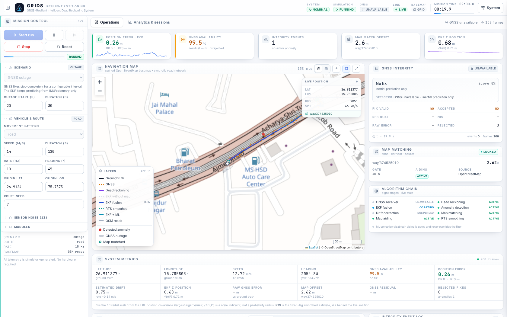
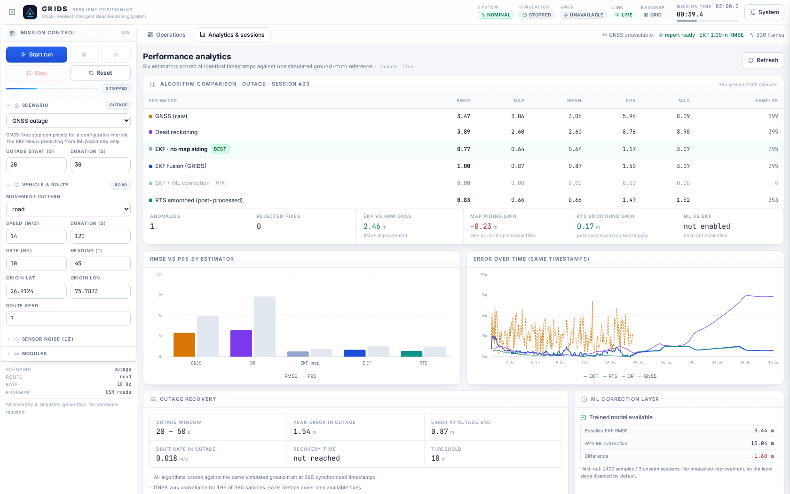
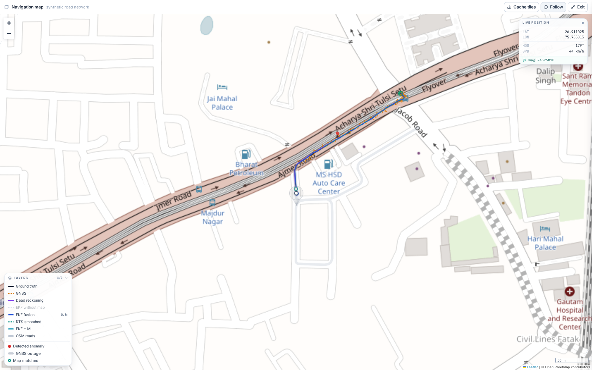
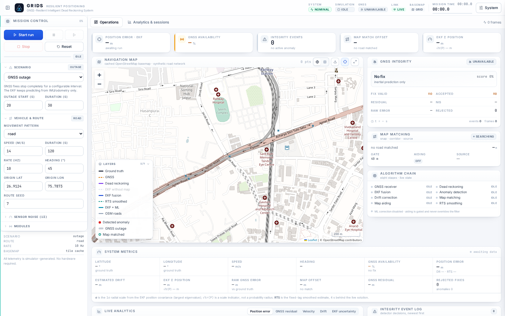

# GRIDS — GNSS-Resilient Intelligent Dead Reckoning System

GRIDS is an independent navigation-technology platform for **resilient positioning**:
it keeps estimating where a vehicle is when GNSS becomes unavailable, degraded, or
untrustworthy. The platform ships as a complete, self-contained product: a
physics-based vehicle/sensor simulator, a dead-reckoning integrator, a 6-state
Extended Kalman Filter with a parallel no-map shadow filter for honest A/B
measurement, a fixed-lag **RTS smoother** for the retrospective track, an
explainable GNSS anomaly detector with graduated response, drift monitoring,
**road-network map matching with a gated cross-track constraint** on a real
OpenStreetMap basemap, a real-time WebSocket stream, a two-view mission-control
dashboard, and ground-truth-scored performance analytics persisted in SQLite.

> **Data provenance.** Everything the platform displays is produced by the
> simulator that ships in this repository. It is *simulated* navigation data.
> Simulated accuracy does not establish real-world performance, and the anomaly
> detector is a statistical detector for injected faults — not a certified
> anti-spoofing system. These limits are stated in the API (`/api/system/info`),
> in the analytics notes of every report, and in the UI.



*Operations view mid-outage: the vehicle follows a real Jaipur street network on a
cached OpenStreetMap basemap while GNSS is unavailable; EKF, DR and the map-matched
position stay live, with GNSS-integrity diagnostics and per-module health on the right.
Every value comes from the backend in real time.*

---

## 1. Problem statement

Satellite positioning is the default source of vehicle position, but it is not
always available and not always honest. GNSS can disappear (urban canyons,
tunnels, jamming), degrade slowly (multipath, ionospheric disturbance, aiding
failures) or be deliberately spoofed. A navigation system that simply trusts the
receiver will either stop navigating or, worse, confidently follow a false track.

GRIDS addresses this by combining GNSS with inertial dead reckoning, fusing both
in an EKF that can coast on inertial data, and *judging* each GNSS fix before it
is allowed to influence the estimate.

---

## 2. What is implemented (and what is not)

| Capability | Status | Notes |
|---|---|---|
| Vehicle motion simulator (7 patterns incl. street-graph following, configurable speed/duration/noise) | ✅ | Ground-truth trajectory is the scoring reference |
| GNSS simulator: normal / outage / drift / spoofing | ✅ | Missing fixes are `None`, never zero |
| IMU + odometry sensor simulation with true biases | ✅ | DR genuinely accumulates error |
| Dead reckoning (EN frame, heading-aware) | ✅ | Independent of the EKF, used as a baseline |
| Extended Kalman Filter (6 states, NIS gating, Joseph update) | ✅ | Numerically stabilised, covariance exposed |
| GNSS anomaly detection (5 explainable detectors) | ✅ | Accept / down-weight / reject / hold-out policy |
| Drift monitoring + bounded correction | ✅ | Correction blocked unless GNSS is demonstrably healthy |
| Map matching + map-aided cross-track constraint | ✅ | Real OpenStreetMap road network; synthetic lattice offline; the constraint is gated and self-disabling |
| Fixed-lag RTS smoother (retrospective track) | ✅ | 4 s lag, scored at each sample's own timestamp |
| Basemap tiles cached by the backend | ✅ | Real map background with no internet after the first look |
| ML drift correction | ⚠️ optional, **disabled by default** | Trained + honestly evaluated; no measured improvement on held-out sessions in this MVP |
| Real-time WebSocket stream + REST API | ✅ | Socket is a pure subscriber; no duplicate loops |
| Performance analytics vs ground truth | ✅ | MAE, RMSE, mean, max, P95, outage recovery |
| SQLite persistence (sessions, results, metrics, anomalies) | ✅ | Batched writes, not row-by-row |
| Docker Compose deployment | ✅ provided | See §11 |
| Real hardware / real receivers / IMU drivers | ❌ out of scope | No hardware is required anywhere |

---

## 3. System architecture

```
                    ┌──────────────────────────────┐
                    │   React + Vite dashboard     │
                    │  Leaflet map · Recharts ·    │
                    │  React components · Tailwind │
                    └───────────┬──────────────────┘
                                │  REST (/api/*)   WebSocket (/api/ws/simulation)
                    ┌───────────▼──────────────────┐
                    │        FastAPI backend       │
                    │                              │
                    │  routes/  simulation · navigation · analytics · health · realtime
                    │  services/ simulation_service · navigation_service · analytics_service · osm_service
                    │  algorithms/ dead_reckoning · ekf · gnss_anomaly · drift_correction · map_matching
                    │  core/  simulator · coordinate_utils · state_manager
                    │  ml/    train · inference · model
                    │  models/ schemas (Pydantic) · database (SQLAlchemy)
                    └───────────┬──────────────────┘
                                │
                    ┌───────────▼──────────────────┐
                    │   SQLite (SQLAlchemy ORM)    │
                    │  sessions · batched results ·│
                    │  metrics · anomaly events    │
                    └──────────────────────────────┘
```

Key architectural decisions:

* **One simulation loop, owned by the service.** `SimulationService` runs a single
  asyncio task per run. WebSocket clients only subscribe, so reconnecting or
  opening a second tab can never spawn a duplicate loop.
* **Metric frame everywhere.** All estimation happens in a local East–North
  tangent plane anchored at the trajectory origin; latitude/longitude is only
  used at the edges (map display, API payloads, ground-truth scoring).
* **Filter baseline is never replaced.** Drift correction moves the DR branch at
  most, and only while the GNSS channel is healthy. The EKF is always the
  reference solution.
* **Storage is coarse-grained on purpose.** Frames are buffered and flushed in
  batches of ~250 as compact columnar JSON; only discrete anomaly events are
  written individually.
* **Every enhancement is measurable.** The no-map shadow filter and the
  RTS-smoothed track both run in the same pipeline, so the report states the
  measured delta for map aiding and smoothing instead of asserting a benefit.
* **Online map data is an enrichment, never a dependency.** Road geometry and
  basemap tiles are fetched once and cached on disk; a dead network changes the map
  backdrop, not the navigation, the metrics or the tests.

---

## 4. Technology stack

**Frontend** React 18, Vite 5, Tailwind CSS 3, Leaflet 1.9 + React-Leaflet 4,
Recharts 2, Lucide icons.
**Backend** Python 3.11+, FastAPI, Uvicorn, Pydantic v2, NumPy, SciPy, Pandas,
scikit-learn, SQLAlchemy 2, native WebSockets.
**Storage** SQLite.
**ML** scikit-learn (`GradientBoostingRegressor`, multi-output), joblib.
**Infra** Docker, Docker Compose, Python virtualenv, Git.

No external service is required for any core function: the simulator, the filters,
the detector, persistence and every chart work offline. OpenStreetMap road geometry
and basemap tiles are *optional enrichments* — they are fetched once, cached on
disk (12 h for roads, forever for tiles) and skipped silently when unreachable
(`GRIDS_MAP_ONLINE=0` disables them explicitly).

---

## 5. Navigation engine

### 5.1 Frames and conventions

* Local tangent plane (equirectangular WGS-84 scaling) at the origin: `east`,
  `north` in metres. Accurate to centimetres over the few kilometres a run covers.
* Heading ψ is **clockwise from north** (compass convention), wrapped to (−π, π].
* Ranges/noise are in metres; biases in m/s² and rad/s.

### 5.2 Vehicle & sensor simulator (`core/simulator.py`)

Routes are built as dense polylines in the EN frame for six patterns: `straight`,
`left_turn`, `right_turn`, `curved`, `random`, `custom` (user waypoints). The
vehicle follows the polyline with a bounded longitudinal acceleration and slows
in curves, producing realistic yaw rates and lateral accelerations.

Sensors are generated from ground truth:

| Sensor | Model |
|---|---|
| GNSS position | truth + injected fault (+ optional bias) + N(0, σ_gnss²) per axis |
| Accelerometer | true longitudinal accel + true bias `b_a` + N(0, σ_a²) |
| Gyroscope | true yaw rate + true bias `b_g` + N(0, σ_g²) |
| Wheel speed | true speed + N(0, σ_v²) |

Fault injection:

* **outage** — no GNSS measurement at all inside the window (`None`, never 0),
* **drift** — bias magnitude grows as `min(max, rate × t_after_onset)` in a slowly
  rotating direction,
* **spoofing** — an instant jump plus a continuous false walk in a seeded
  direction, as a coordinated attack would appear.

### 5.3 Dead reckoning (`algorithms/dead_reckoning.py`)

```
v_{k+1}   = v_k + (a_m − b_a)·Δt
ψ_{k+1}   = ψ_k + (ω_m − b_g)·Δt
e_{k+1}   = e_k + v_{k+1}·sin ψ_{k+1}·Δt
n_{k+1}   = n_k + v_{k+1}·cos ψ_{k+1}·Δt
```

Velocity is a complementary blend of the integrated accelerometer and wheel
odometry (weight configurable), which bounds accelerometer drift the way a
production system would. DR is kept deliberately separate from the EKF so the
dashboard can show an honest drifting baseline.

### 5.4 Extended Kalman Filter (`algorithms/ekf.py`)

State `x = [e, n, v, ψ, b_a, b_g]ᵀ`.

**Prediction** (IMU driven; runs with or without GNSS):

```
e'  = e + v'·sin ψ'·Δt          ψ' = ψ + (ω_m − b_g)·Δt
n'  = n + v'·cos ψ'·Δt          v' = v + (a_m − b_a)·Δt
b_a' = b_a                       b_g' = b_g
```

Jacobian `F = ∂f/∂x` includes the heading/velocity/bias couplings, e.g.
`∂e'/∂ψ = v'·cos ψ'·Δt`, `∂e'/∂b_a = −sin ψ'·Δt²`.

**Covariance** `P = F P Fᵀ + Q`, with process noise built from accelerometer and
gyroscope noise plus random-walk terms on both biases.

**Measurement updates**

| Sensor | z | H | R |
|---|---|---|---|
| GNSS | [e, n] | [I₂ \| 0] | σ²·I₂ (inflatable when down-weighting) |
| Wheel speed | [v] | [0 0 1 0 0 0] | σ_v² |
| Compass (optional) | [ψ] | [0 0 0 1 0 0] | σ_ψ² |

**Gating.** Every GNSS fix yields innovation `y = z − Hx`, `S = H P Hᵀ + R`, and
`NIS = yᵀ S⁻¹ y`. Fixes whose NIS exceeds the χ²(2, 0.999) gate are rejected
without touching state or covariance, and anomaly detection can additionally
inflate `R`.

**Stability.** Joseph-form covariance update `P = (I−KH)P(I−KH)ᵀ + K R Kᵀ`,
explicit symmetrisation, eigenvalue flooring, wrapped heading, and non-negative
speed clamping.

**Uncertainty exposure.** The API/UI report both `σ_pos = √λ_max(P_ee, P_nn)` (a
1σ radial scale) and `√tr(P_pos)`. Neither is labelled "confidence": no
probability-of-containment is computed.

### 5.5 GNSS anomaly detection (`algorithms/gnss_anomaly.py`)

Five independent, explainable detectors, each producing a severity in [0, 1]:

1. **position_jump** — geodesic step between consecutive fixes vs what the vehicle
   could physically have travelled (`allowed = 25 m + 6σ + (|v| + 20 m/s)·Δt`).
2. **velocity** — implied ground speed over a ~1 s baseline vs fused speed, with a
   noise-derived tolerance (per-sample GNSS noise dominates at high rates).
3. **heading** — implied course vs fused heading, using a circular tolerance
   `atan2(3σ√2, jump)`; skipped when displacement is below `4σ√2`.
4. **residual** — innovation magnitude and NIS.
5. **drift** — windowed (10 s) mean residual bias, compared with a *significance
   floor* `max(3 m, 5σ/√N)`, which makes slow corruption detectable without
   false-alarming on noise.

Response policy (graduated, not binary):

| Combined severity | Action | GNSS status |
|---|---|---|
| < 0.45 | normal update | `healthy` |
| ≥ 0.45 | update with inflated measurement noise (≥8× σ for drift) | `degraded` |
| kinematically impossible transient ≥ 0.85 | hard reject | `suspicious` |
| persistent bias ≥ 0.45 **and** mean > 3 m **and** own uncertainty ≤ 60 m | hard reject, coast on inertial | `suspicious` |
| after any rejection | hysteresis hold-out until the innovation returns inside the κ gate (1.5 s … 45 s) | `suspicious` |

The last condition matters: if the filter itself is uncertain (long coast), a
persistent residual is more likely filter divergence than a GNSS fault, and a hard
reject would be unjustified.

### 5.6 Drift monitoring and correction (`algorithms/drift_correction.py`)

`DriftMonitor` tracks DR↔EKF separation, DR↔truth error (available in simulation
for evaluation), EKF↔truth error, the running mean of accepted GNSS residuals and
a smoothed drift rate. `DriftCorrector` applies a *bounded* correction
(`gain = 0.08`, `max 2.5 m` per step) to the DR branch only, and only when the
last five GNSS fixes were accepted without anomaly. The EKF is never modified.

### 5.7 Map matching and map aiding (`algorithms/map_matching.py`, `services/map_data_service.py`)

The matcher projects the fused position onto a **road network of real drivable ways**:

* **Road data.** `services/map_data_service.py` fetches OpenStreetMap geometry with
  the plain OSM map-data endpoint (bbox query, XML — about a second, no query
  language), keeps Overpass as a secondary source, and caches the result on disk for
  12 h. It filters to drivable `highway` classes and builds the local EN network.
* **Offline behaviour.** With no network the caller keeps the synthetic lattice
  (a hinted street grid or the simulated route), the UI keeps its cached basemap
  tiles, and every metric stays available.
* **Search.** A 50 m spatial hash keeps nearest-segment search O(local) on
  networks of thousands of segments (≈0.5 ms per match).
* **Matching.** Snap distance gate (40 m), temporal smoothing, and a "no map →
  unmatched" path. The map shows the snapped point and the offset to the fused track.
* **Map aiding.** While GNSS is *not* delivering accepted fixes, the road centre
  line is applied as a **soft cross-track pseudo-measurement** (`H = [n_e, n_n]`,
  σ from the match offset). It is only allowed when

  1. the network is a surveyed street network (`source == "osm"`),
  2. the exponentially averaged match offset over trusted fixes is ≤ 5 m,
  3. the filter's own 1σ position is ≤ 20 m,
  4. the per-step offset is ≤ 5 m, and
  5. the constraint has not been discredited (≥ 25 delivered-but-rejected fixes
     while aiding was active ⇒ aiding is switched off for the rest of the run).

  A parallel **no-map shadow filter** (`ekf_nomap`) always runs the identical model
  without aiding, so the report can state the measured `map_vs_nomap` RMSE delta
  instead of claiming a benefit. In the reference runs it is small (≤ 0.3 m) and
  occasionally negative — the honest conclusion is that most of GRIDS' outage
  accuracy comes from the IMU/odometry model, not from the map.

### 5.8 Optional ML correction (`ml/`)

Features available at run time only (innovation components, availability, NIS,
uncertainty, speed, |yaw rate|, time since fix, residual, rejected flag, anomaly
score). The model predicts the EKF residual in EN metres and the correction is
subtracted from the EKF position; it is never applied while GNSS is absent.

`python -m app.ml.train` trains on 6 simulated sessions and evaluates on 3
**held-out sessions with unseen seeds**. In this MVP the measured held-out result
was *worse* than the EKF baseline (RMSE 10.04 m vs 8.44 m over the mixed test
set), so the layer stays **disabled by default** and the dashboard shows the
measured delta instead of assuming an improvement.

### 5.9 Fixed-lag RTS smoother (`algorithms/smoother.py`)

A Kalman filter may only use measurements up to *now*. For every step the engine
also stores `x_k|k`, `P_k|k`, the transition Jacobian and the predicted pair
`x_k|k-1`, `P_k|k-1`, which is exactly what a Rauch-Tung-Striebel pass needs. Every
step the backward recursion runs from the newest sample down to a fixed lag of 4 s
(`lagged_point`, cost O(lag), not O(window)) and the result is written back into the
**frame of its own timestamp**. Two consequences that matter:

* the smoothed track is not a second live estimate — it is retrospective, behind by
  the lag, and the dashboard labels it as such;
* it is scored against the ground truth of *its own* sample, never against "now",
  which is the mistake that makes smoothing look either magical or broken.

The heading component is differenced with wrapping, so crossing the ±180° branch cut
cannot inject a large false correction.

### 5.10 Per-step pipeline (`services/navigation_service.py`)

```
 1 simulator step            → ground truth + IMU/odometry/GNSS (street-graph route)
 2 EKF predict (IMU)         → survives outages by construction
   + parallel no-map shadow filter (identical model, no map aiding)
 3 GNSS innovation (no update) → NIS, residual
 4 anomaly evaluation        → score, reason, graduated policy
 5 GNSS update if trusted    → EKF NIS gate as second line of defence
 6 odometry speed update     → GNSS-independent
 6b map-aided cross-track    → only while coasting + all five gates pass
 7 dead-reckoning integration
 8 bounded DR correction     → only while GNSS is healthy
 9 drift monitoring (+ optional ML)
 9b fixed-lag RTS smoothing  → written back into the past frame
10 map matching (throttled, last fix held between updates)
11 frame assembly           → geodetic coords, errors vs truth, module health
```

---

## 6. Performance analytics

Every estimator is scored at the **same timestamps** against the **same ground
truth**: MAE, RMSE, mean, max, P95 and sample count for **six estimators** — raw
GNSS, dead reckoning, the no-map shadow EKF, the map-aided EKF, the optional
EKF+ML variant and the RTS-smoothed track — plus outage peak error, error at
outage end, drift rate during the outage, time to recover below 10 m, anomaly
counts and rejected-measurement counts. Comparisons are never made between
misaligned samples, and two deltas are reported explicitly:

* `map_vs_nomap_rmse_m` — how much the cross-track map constraint actually bought
  (positive = aiding helped), measured against the always-running shadow filter;
* `smoothing_vs_ekf_rmse_m` — how much the retrospective RTS pass bought.

Reference results from `scripts/run_scenarios.py` (120 s, 10 Hz, seed 42,
σ_gnss = 2.5 m — *simulated*, street-graph routes on Jaipur road geometry):

| Scenario | GNSS | DR | EKF no-map | **EKF** | **RTS** | map-aid Δ | smoothing Δ |
|---|---|---|---|---|---|---|---|
| normal, street route | 3.57 | 1.68 | 0.63 | **0.63** | **0.42** | 0.00 | +0.21 |
| normal, curved route | 3.49 | 1.67 | 0.51 | **0.51** | **0.31** | 0.00 | +0.20 |
| outage 30–70 s, street route | 3.56 | 3.05 | 0.68 | **0.71** | **0.54** | −0.02 | +0.17 |
| outage 30–70 s, curved route | 3.50 | 11.60 | 4.88 | **4.88** | **4.12** | 0.00 | +0.76 |
| drift 0.4 m/s from 20 s | 21.35 | 28.22 | 26.49 | 26.49 | 24.81 | 0.00 | +1.68 |
| spoofing, 70 m jump at 25 s | 107.53 | 50.46 | 6.27 | **6.27** | **5.85** | 0.00 | +0.42 |
| spoofing, street route | 107.53 | 5.70 | 0.97 | **1.30** | **1.18** | −0.33 | +0.12 |
| complex (random route + outage) | 3.53 | 6.08 | 0.52 | **0.52** | **0.39** | 0.00 | +0.13 |

RMSE in metres, lower is better. Deltas are RMSE gains in metres (positive = the
extra stage helped on that run).

Reading the table honestly:

* The fused EKF is **~5–7× better than raw GNSS** on normal runs and stays within a
  few metres through a 40 s outage, where pure dead reckoning drifts to 3–12 m and a
  curved route without map aiding to 4.9 m.
* Under spoofing the detector rejects the corrupted channel and the filter coasts on
  IMU data: GNSS RMSE is 107 m while the fused track stays ≈ 1–6 m.
* The RTS pass is a consistent, small improvement (0.1–1.7 m) and is free — it only
  needs the data the filter already produced.
* **Map aiding is not a headline win.** Gated as described in §5.7 it buys at most a
  few decimetres here, because the IMU/odometry model is already good. It is kept
  because it protects against lateral divergence during long outages, and it is
  reported with its measured sign, sometimes negative.
* **GNSS drift is the documented weakness.** A slow bias is indistinguishable from a
  real position offset, so once the detector has to re-accept the channel the fused
  track follows the bias (EKF 26.5 m ≈ GNSS 21.4 m). Rejecting it would be worse —
  the vehicle would dead-reckon on a biased IMU. This is stated in the UI too.
* The ML layer is off: on held-out sessions it measured **10.04 m vs 8.44 m** for the
  baseline, so the honest recommendation is `recommended_default = false`.

These numbers are reproduced by the script on demand; they are not constants in
the code.

## 7. REST API

Interactive documentation: `http://localhost:8000/docs`.

| Method | Path | Purpose |
|---|---|---|
| GET | `/api/health` | liveness + DB check |
| GET | `/api/system/info` | capabilities, limits, data-provenance disclaimer |
| GET | `/api/simulation/scenarios` | ready-to-run scenarios + defaults |
| GET | `/api/simulation/patterns` | available movement patterns |
| GET | `/api/simulation/status` | state, progress, active config |
| POST | `/api/simulation/start` | start a run (validated `SimulatorConfig`) |
| POST | `/api/simulation/pause` \| `resume` \| `stop` \| `reset` | lifecycle |
| GET | `/api/navigation/current` | latest synchronised frame |
| GET | `/api/navigation/history?limit=&stride=` | down-sampled frames |
| GET | `/api/navigation/route` | planned route, outage window, map source |
| GET | `/api/navigation/anomalies` | discrete anomaly events |
| GET | `/api/navigation/modules` | module health |
| GET | `/api/navigation/smoothed` | retrospective RTS track (fixed-lag, own timestamps) |
| GET | `/api/map/roads?lat=&lon=&radius_m=` | real road geometry (OSM, cached) |
| GET | `/api/map/tile/{z}/{x}/{y}.png` | cached basemap tile (204 when unknown) |
| POST | `/api/map/prefetch?lat=&lon=` | warm the tile cache around a point |
| GET | `/api/map/status` | online-map availability, tile cache size |
| GET | `/api/analytics/summary` | live running metrics |
| GET | `/api/analytics/compare?include_series=` | full comparison report |
| GET | `/api/analytics/ml` | ML model status + held-out evaluation |
| GET | `/api/analytics/sessions` | stored sessions with metrics |
| GET | `/api/analytics/sessions/{id}` | config, metrics, series, anomalies |
| WS | `/api/ws/simulation` | live stream (`navigation_update`, `state_change`, …) |

Example:

```bash
curl -X POST http://localhost:8000/api/simulation/start \
  -H 'Content-Type: application/json' \
  -d '{"scenario":{"scenario":"spoofing","spoof_onset_s":15},
       "duration_s":60,"rate_hz":10,"route_pattern":"left_turn","speed_ms":14}'
curl http://localhost:8000/api/navigation/current | jq '.frame | {t, gnss_status, ekf_error_m}'
curl http://localhost:8000/api/analytics/compare | jq '.algorithms'
```

Custom route example:

```json
{"route_pattern":"custom","duration_s":90,
 "custom_waypoints":[{"lat":26.9124,"lon":75.7873},
                     {"lat":26.9200,"lon":75.7950},
                     {"lat":26.9300,"lon":75.7830}]}
```

---

## 8. Simulation scenarios

| Scenario | What the simulator does | What you should observe |
|---|---|---|
| **1 · Normal** | GNSS available throughout with configurable noise | GNSS, DR and EKF all track truth; EKF ~6× better than raw GNSS, RTS a further step |
| **2 · Outage** | GNSS stops entirely for a configurable window | EKF and DR keep moving; error and covariance grow, then recover after the fix returns |
| **3 · Drift** | Bias grows slowly in a near-fixed direction | Windowed-residual detector raises the alarm and the fixes are rejected while it is detectable; once the bias is accepted again the filter follows it (see §13.2 — a common-mode bias is not observable) |
| **4 · Spoofing** | Instant jump + continuous false walk | Jump/velocity/heading detectors fire immediately; fixes rejected; EKF coasts |
| **5 · Complex** | Randomised route with turns, accel/decel, mid-run outage | Navigation continues through aggressive manoeuvres; EKF bounds DR drift |

Scenario 5 is exposed as `scenario: "complex"` and automatically uses the random
route pattern.

**Route patterns** (independent of the scenario): `road` (default — follows the
street graph), `straight`, `left_turn`, `right_turn`, `curved`, `random`, `custom`
(waypoints). The `road` pattern builds its graph from OpenStreetMap ways when the
map data is reachable and from a synthetic street lattice otherwise, clips it to a
600 m window, and then walks it preferring junctions, so the vehicle really drives
on the drawn streets — which is what makes map matching meaningful.

---

## 9. Dashboard

Two views, one shell: a mission-control **Operations** view for driving a run and
an **Analytics & sessions** view for scoring it.

**Design system.** The UI is built on a small, explicit token set rather than
ad-hoc classes:

* **Typefaces** — [Inter](https://rsms.me/inter/) (variable) for UI text and
  JetBrains Mono for every number that changes, so digits stay fixed-width and do
  not jitter while a run streams. Both are **self-hosted** through `@fontsource`,
  so the dashboard renders identically with no network access.
* **Tokens** — a typographic scale (`3xs` → `2xl`), three elevation shadows
  (`shadow-panel`, `shadow-float`, `shadow-inset`), one cool neutral ramp
  (`slate`), and a single accent (blue) plus semantic tones (emerald = healthy,
  amber = degraded, red = rejected).
* **Components** — `panel` / `panel-header` / `panel-title` for surfaces,
  `metric-label` + `metric-value` for data, `chip` + `dot` for state, `field-label`
  for form rows, `icon-btn` / `btn-primary` / `btn-secondary` for actions, and a
  `tab` segmented pair for switching views. Values that change every frame are
  monospaced and tabular; labels are small, uppercase and tracked out.
* Light theme, navy typography, one blue accent, dense-but-legible data layout and
  sticky controls that never scroll away.

**Operations view**

* **Top bar** — product identity, system / simulation / GNSS / link status pills,
  mission clock with progress, and a *System* button that opens the drawer.
* **Mission control** (left rail) — start / pause / resume / stop / reset with a
  progress bar, then collapsible sections: scenario + fault parameters, vehicle &
  route (including the street-graph `road` pattern, origin, seed, heading), sensor
  noise 1σ, and module toggles (map matching, map aiding, real map data, ML).
* **KPI strip** — position error (with DR and RTS in the subtitle), GNSS
  availability, integrity events, live map-match offset and the EKF position σ.
* **Navigation map** (Leaflet) — **real OpenStreetMap basemap served and cached by
  the backend** with the ground-truth, GNSS, DR, no-map EKF, EKF, RTS and EKF+ML
  tracks as independently toggled layers; vehicle heading marker; OSM road overlay;
  outage stretches highlighted along the true path; anomaly markers with popups;
  map-match snap point joined to the fused track by an offset line; scale bar,
  follow-vehicle mode, offline-graticule fallback, one-click tile caching and a
  true full-screen mode. Wheel zoom is deliberately disabled in the inline card
  (a hint says so) so the page still scrolls; the full-screen view enables it.
* **GNSS integrity** — status, fix validity, residual, NIS, raw error, rejected
  count, per-detector severity bars and the detector's plain-language explanation.
* **Map matching** — matched road name, offset, gate, aiding state, road source.
* **Algorithm chain** — live state of GNSS, DR, EKF, anomaly detection, drift
  correction, map matching, map aiding, RTS smoothing and ML.
* **System metrics** — latitude/longitude, speed/heading, availability, position
  error vs DR vs GNSS, drift estimate, EKF 1σ, map offset, residual, rejected fixes,
  anomalies, with a footnote explaining what σ and √tr(P) do and do not mean.
* **Live analytics** — five switchable charts (position error, GNSS residual +
  anomaly score, velocity, drift, EKF uncertainty vs actual error) with outage
  shading, plus an integrity event log.
* **System drawer** — runtime, map-data provenance and cache state, API entry
  points, and the limitations of the current build, stated where an operator will
  actually read them. Dismissed by the X button, the scrim or `Esc`.

**Analytics & sessions view**

* Comparison table over the six estimators with the best RMSE highlighted, plus
  MAE / mean / P95 / max / sample count, and delta tiles for EKF-vs-GNSS,
  map-aiding gain, smoothing gain and ML gain.
* RMSE/P95 bar chart and per-timestamp error curves for the same run.
* Outage-recovery panel (peak error, error at outage end, drift rate, recovery time).
* Measured ML evaluation panel.
* Stored-session archive in SQLite; click any row to load that run's report.



*Analytics view: per-estimator RMSE/MAE/P95/max at identical timestamps, the
map-aiding and RTS deltas, outage recovery figures, the measured ML evaluation and
the stored-session archive.*



*Full-screen map during an outage: the vehicle stays on the real street network
while GNSS is denied, with the retrospective RTS track behind it.*



*Idle dashboard: the street-following route is planned on the cached OpenStreetMap
basemap before the run starts; controls, KPIs and diagnostics are all live.*

---

## 10. Local development

Requirements: Python 3.11+, Node 18+.

```bash
git clone <repo> grids && cd grids

# backend
cd backend
python -m venv .venv && source .venv/bin/activate      # Windows: .venv\Scripts\activate
pip install -r requirements.txt
uvicorn app.main:app --reload --port 8000               # http://localhost:8000/docs

# frontend (new terminal)
cd frontend
npm install
npm run dev                                             # http://localhost:5173
```

The Vite dev server proxies `/api` (including WebSocket upgrade) to
`http://127.0.0.1:8000`, so browser code only ever uses relative URLs. Change the
proxy target with `VITE_BACKEND_PROXY` if the API runs elsewhere.

Headless runs (no UI at all):

```bash
cd backend
python -m app.ml.train --sessions 6 --duration 90        # optional ML layer
cd ..
python scripts/run_scenarios.py --duration 120 --seed 42 --persist
```

---

## 11. Docker execution

```bash
cp .env.example .env
docker compose up --build
# dashboard  → http://localhost:5173
# API docs   → http://localhost:8000/docs
docker compose down          # add -v to drop the SQLite volume
```

* `backend` runs Uvicorn on **8000**, exposes `/api/health` as a healthcheck.
* `frontend` builds the Vite bundle and serves it through Nginx on **5173**,
  proxying `/api/*` (and the WebSocket) to `backend:8000` — no hardcoded URLs.
* Named volumes persist `grids_data` (SQLite) and `grids_ml` (model artifacts).

---

## 12. Testing

```bash
cd backend
python -m pytest -q                 # 103 tests, ~25 s
python -m pytest tests/test_api.py -q -v
```

End-to-end UI check (needs the backend on :8000 and the dev server on :5173):

```bash
python scripts/verify_ui.py         # 19 headless-browser checks, exits non-zero on failure
```

It drives the real dashboard: load, start/pause/resume, all five chart tabs, map
layers, the system drawer, stop-and-score, the analytics page, loading a stored
session, and a spoofing run — failing on any JavaScript error.

Regenerate the documentation screenshots from the live app (same ports):

```bash
python scripts/capture_screens.py   # writes docs/images/*.png at 1680x1050
```

Coverage:

| File | Focus |
|---|---|
| `test_coordinates.py` | local↔geodetic round trip, scale factors, haversine, bearing, angle wrapping |
| `test_simulator.py` | route continuity/geometry, motion, sensor noise, outage produces `None` (not 0), drift growth, spoof injection, seed determinism |
| `test_dead_reckoning.py` | exact integration of straight/accel/turn motion, bias handling, odometry blending, correction, geodetic round trip |
| `test_ekf.py` | prediction, covariance growth, GNSS/velocity/heading updates, Joseph stability over 400 steps, NIS gating, outage coasting, bias observability, reset |
| `test_anomaly.py` | zero rejections on clean GNSS, jump detection, persistent-drift detection, graduated response, status classification, explainability fields |
| `test_drift_and_metrics.py` | drift monitor/rate, bounded correction, segment projection, snap gating, no-map fallback, error statistics, outage recovery metrics |
| `test_scenarios.py` | full pipeline for all five scenarios + every route pattern (incl. the street-graph route), outage keeps navigating, spoof rejected, EKF vs baselines, map matching advisory |
| `test_api.py` | health/info, scenario catalogue, validation failures (422), full lifecycle (start → pause → resume → stop → reset), analytics, session retrieval (404 handling), WebSocket streaming |
| `test_navigation_upgrades.py` | street-graph routes really follow the ways, simulator starts aligned with the route, map aiding is gated (never on a synthetic network, never while GNSS is trusted, discredit path), spatial index equals brute force, fixed-lag smoother scores its own timestamps and stays bounded, six-estimator report + deltas, dead map service degrades without raising |
| `test_regression.py` | policy guards: ML layer stays opt-in, detection report is self-consistent, zero rejections on a clean run, EKF beats raw GNSS, outage frames carry no GNSS coordinates, drift correction suspended while GNSS is untrusted, run-to-run reproducibility |

All tests use deterministic seeds and a temporary SQLite database.

---

## 13. Known limitations

1. **Simulated data only.** No receiver, IMU or CAN data is ingested; the physics
   is a kinematic model with noise and bias, not a hardware model.
2. **Slow drift is the hardest case.** The detector flags it and stops trusting
   the channel, but once the bias is accepted again the fused track follows it
   (measured: EKF 26.5 m RMSE vs GNSS 21.4 m on the reference drift run). A slow
   common-mode bias is not observable from inertial data alone, so no honest
   filter can remove it; an external absolute reference would be required.
3. **The ML correction layer does not currently help.** Its held-out evaluation
   is worse than the EKF baseline, so it is disabled by default.
4. **Loose/loose-coupling only.** There is no tight coupling to raw GNSS
   observables (pseudoranges, Doppler), so no satellite-level fault detection.
5. **2-D kinematics.** No vertical channel, heading from a magnetometer model, or
   wheel-slip/vehicle-dynamics model beyond the odometry blend.
6. **Map matching is a nearest-segment matcher**, not a full HMM/topology
   inference, so in dense parallel-road areas it can pick the wrong carriageway.
   Map aiding is therefore gated, limited to surveyed OSM networks and
   self-disabling when it disagrees with the receiver; its measured benefit is
   small (§6) rather than a headline claim.
7. **Online map data is optional.** Road geometry and basemap tiles are fetched
   and cached on first use; with no network the dashboard falls back to its cache
   or the offline graticule, and the simulator to a synthetic street lattice.
8. **The RTS track is retrospective.** It lags the live solution by 4 s by design
   and is not available for the first ~4 s of a run.
9. **Single vehicle, single active run** — the state manager keeps one active run
   at a time (completed runs remain available for comparison).
10. **Docker image was authored but not executed in this environment** (no Docker
   daemon available where the project was built); the local workflow, API,
   WebSocket, and full test suite were executed and verified.

---

## 14. Future improvements

* Tight coupling with raw GNSS measurements and RAIM-style satellite-level checks.
* IMM/UKF variants for aggressive manoeuvres; 3-D state with a barometer.
* Learned anomaly detection (sequence model) benchmarked against the statistical
  detector, with the same honest held-out protocol as the ML layer.
* HMM map matching with road topology and OSM ingestion pipeline.
* Multi-vehicle simulation and shared-map integrity monitoring (cooperative
  spoofing detection).
* Server-side run replay with time-scrubbing and report export (PDF/CSV).

---

## 15. Repository layout

```
grids/
├── backend/
│   ├── app/
│   │   ├── main.py config.py
│   │   ├── api/router.py + routes/{simulation,navigation,analytics,map_data,health,realtime}.py
│   │   ├── core/{simulator,coordinate_utils,state_manager}.py
│   │   ├── algorithms/{dead_reckoning,ekf,smoother,gnss_anomaly,drift_correction,map_matching}.py
│   │   ├── services/{navigation_service,simulation_service,analytics_service,map_data_service}.py
│   │   ├── models/{schemas,database,database_setup}.py
│   │   ├── ml/{model,inference,train}.py
│   │   └── utils/{metrics,logging}.py
│   ├── tests/                 (103 tests)
│   ├── requirements.txt  Dockerfile
├── frontend/
│   ├── src/
│   │   ├── components/        (map, metrics, panels, controls, charts, analytics, settings)
│   │   ├── hooks/useSimulationSocket.js
│   │   ├── pages/Dashboard.jsx  services/api.js  utils/format.js
│   ├── Dockerfile  nginx.conf  vite.config.js  tailwind.config.js
├── scripts/{run_scenarios.py,verify_ui.py}
├── docs/{ARCHITECTURE.md,images/}
├── docker-compose.yml  .env.example  README.md
```
